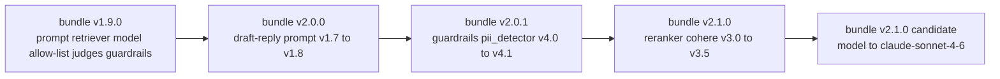

# Chapter 05 — Per-Tenant Versioning and the Replay Harness

## Why this chapter exists

Chapter 01 named three gate dimensions in the mod-109 budget — deployment-mode fit, change-management legibility, and *replay fidelity*. Chapter 02 drew the deployment-mode lines. Chapters 03 and 04 wired flags and canaries. This chapter is where replay fidelity becomes a capability instead of a promise.

The stake is concrete. Six months after go-live, the customer's auditor — HIPAA for Archetype A, agency IG for Archetype B, ECB joint supervisory team for Archetype C — points at a single row in the audit log and asks: "why did this member, on this date, at this time, receive this answer?" The honest answer requires three things to be true at once. The full invocation was captured. The exact artefact bundle live at that moment is still recoverable. The system can re-run the invocation end-to-end against that bundle and produce the same trajectory. Miss any of the three and the answer becomes a reconstruction project, which is a finding.

"Version the prompt" is the first instinct and it is not enough. A prompt without its retriever is a question with no corpus. A retriever without its reranker is a sampling of the corpus. A model without its decoding config is a distribution, not an answer. The unit of versioning has to be the whole bundle, every artefact that materially shapes the output, with explicit lineage back to the previous bundle and forward to approvals.

## What a per-tenant artefact bundle contains

The bundle is a single manifest, one YAML file in a Git repo, that names and hashes every artefact a given tenant's workflow depends on at a given version. It is per-tenant because the prompts, the retriever index, the tool allow-list, and the gateway policy are per-tenant from mod-104 through mod-106. It is a manifest, not the artefacts themselves — the artefacts live in their native registries (prompt registry, vector-store, model provider, container registry) and the manifest pins them by version and hash.

```yaml
bundle:
  name: member-inquiry
  tenant: customer-a
  version: v2.1.0
  channel: stable
  prompts:
    - name: inquiry-triage
      version: v3.1.2
      hash: sha256:abc123...
    - name: draft-reply
      version: v1.8.0
      hash: sha256:def456...
  retriever:
    index_version: v12
    reranker: cohere-rerank-v3.5
    k: 8
    rerank_top_k: 25
  model:
    provider: bedrock
    model_id: anthropic.claude-3-7-sonnet-20250219-v1:0
    decoding:
      temperature: 0.0
      max_tokens: 1024
  tool_allow_list:
    - name: lookup-member-record
      version: v2
      scope: read
    - name: update-case
      version: v1
      scope: write
  judges:
    - name: pairwise-preference
      model: anthropic.claude-3-5-sonnet-v2
      prompt_version: v2.0
  guardrails:
    pii_detector: v4.1
    output_filter: v3.0
  gateway:
    zero_retention: true
    region: us-east-1
    egress_policy: deny-all-except-bedrock-vpce
  approval:
    ticket: CAB-2026-10-0319
    approved_by: [fde-lead@vendor, platform-eng@customer-a, compliance@customer-a]
    approved_at: 2026-10-28T14:30:00Z
```

Section by section. **`prompts`** pins every prompt the workflow uses — triage, draft, judge-upstream, error-handler — with the content hash, so an edit that bumps the version without bumping the hash is a lint failure. Backed by the prompt architecture from [mod-104 Chapter 04](../mod-104-llm-app-in-customer-envs/04-prompt-architecture.md). **`retriever`** pins the index snapshot id, the reranker model, and the retrieval parameters (`k`, `rerank_top_k`) that materially change which documents the model sees — the retriever shape from [mod-105](../mod-105-grounding-on-customer-data/). **`model`** pins the provider, model id (including provider-side version suffixes like Bedrock's `-v1:0`), and decoding parameters; temperature-zero is listed because it is a replay-determinism pre-requisite, covered below. **`tool_allow_list`** pins the exact tools and their versions, with scope (`read` vs `write`) — the allow-list shape from [mod-106 Chapter 03](../mod-106-agentic-workflows-on-enterprise/03-tool-allow-list.md) and [Chapter 04](../mod-106-agentic-workflows-on-enterprise/04-human-in-the-loop.md). **`judges`** pins the online-eval and promotion-time judges with their own prompt versions — from [mod-107 Chapter 05](../mod-107-eval-eng-on-customer-data/05-online-eval-and-judges.md); without this, a judge-prompt edit silently changes the eval signal. **`guardrails`** pins PII detectors and output filters, which are themselves versioned models or rule-sets. **`gateway`** pins the model-gateway configuration — zero-retention assertion, region, egress policy — from [mod-104 Chapter 03](../mod-104-llm-app-in-customer-envs/03-model-gateway-in-customer-env.md) and [mod-108 Chapter 05](../mod-108-enterprise-security-and-compliance/05-data-contract.md). **`approval`** pins the CAB ticket, signatories, and timestamp; this is what makes the bundle legally promotable.

Six artefact classes plus the gateway config plus the approval stub. Any of the six missing and the bundle cannot replay the production trajectory.

## Lineage, not just version numbers

A version number is a label. An audit trail needs the *lineage graph*: this bundle derives from bundle X by changing specifically the retriever's reranker from Cohere Rerank v3.0 to v3.5, approved by ticket CAB-2026-10-0319, on 2026-10-28, in response to regression evidence Y. The graph makes the diff reviewable and the rollback addressable.



Each edge is a single, named, approved change. Fan-in is explicit — if a bundle depends on a shared judge bump, the edge names that too. A lineage graph in a slide is ceremony; a lineage graph *in the manifest repo as a DAG the diff-review surface walks* is architecture.

The tooling that holds this graph is boring on purpose. Plain Git on the manifest repo is the spine — commits, branches, merge commits, and signed tags carry the DAG. The artefact registries sit alongside. [MLflow Model Registry](https://mlflow.org/docs/latest/model-registry.html) tracks model-side versions and stage transitions. [Weights & Biases Artifacts](https://docs.wandb.ai/guides/artifacts/) tracks dataset and eval artefacts with lineage links. [DVC](https://dvc.org/) is a pragmatic choice when retriever indices and gold sets live on object storage and need Git-adjacent pinning. For prompts specifically, the registry can be a Git-backed directory, [PromptLayer](https://promptlayer.com/), or whatever the platform peer standardised on; the bundle pins by version and hash either way.

The manifest repo itself follows the same release discipline as application code — PRs, required reviewers by CODEOWNERS, signed commits, protected branches, and Sigstore attestations on the released manifest hash. The ML-BOM from [mod-108 Chapter 06](../mod-108-enterprise-security-and-compliance/06-ai-supply-chain-provenance.md) references the bundle hash; the bundle references the ML-BOM component ids. The two artefacts are symmetric views of the same system.

## The replay harness

Three functions. Capture, storage, replay.

**Capture.** Every production invocation emits one structured event containing the full inputs and the full trajectory. At minimum: invocation id (UUID), tenant id, workflow name, bundle version (the pin that served the request), timestamp, user id (or hashed equivalent), channel, raw inputs, retrieval query, retrieval results (document ids plus hashes, not just scores), rerank output, prompt rendered (the fully expanded prompt the model actually saw), model request payload, model response payload including any `system_fingerprint`-style metadata the provider returns, tool-call trajectory (each tool call's name, arguments, response, timestamps), HITL interventions (approvals, overrides, reject-with-reason), judge outputs if sampled, guardrail decisions, final output, latency breakdowns, cost breakdown. The gateway from [mod-104 Chapter 03](../mod-104-llm-app-in-customer-envs/03-model-gateway-in-customer-env.md) is the natural capture point; the HITL trajectory ships from the UI layer per [mod-106 Chapter 05](../mod-106-agentic-workflows-on-enterprise/05-agent-observability-and-hitl.md).

**Storage.** A replay-store, not a log. Logs are rotated and sampled; a replay-store is append-only, immutable, and sized for the retention regime. Per-tenant partitioning, encrypted at rest with the tenant's CMK, indexed by at least `(tenant, workflow, timestamp)` and `(tenant, user, timestamp)`. Storage format: one JSON record per invocation for the trajectory + metadata, plus blob references for large context (retrieved documents, attached files). Retention is tenant-regime-specific — 90 days for a non-regulated SaaS workload is normal; six years is the HIPAA floor; seven years is typical for EU financials under DORA; for federal workloads, NARA records-retention schedules apply and vary by record class. <!-- needs-research: confirm HIPAA audit-log retention 6 years from 45 CFR 164.316(b)(2) applicability to AI replay-store contents --> <!-- needs-research: confirm NARA records-retention general schedules relevant to AI-system inference logs -->

**Replay API.** Given an invocation id and a target bundle version, re-run end-to-end. Two legal outputs: *bit-for-bit identical* to the captured trajectory when the target bundle is the bundle that served the invocation and the stack is deterministic; a *diff* otherwise, showing per-step divergence.

```http
POST /replay
Content-Type: application/json

{
  "invocation_id": "0b3f1a6e-...",
  "target_bundle": "member-inquiry@v2.1.0",
  "mode": "diff",
  "determinism": "temperature_zero"
}

# response
{
  "replay_id": "r-74c9...",
  "status": "complete",
  "source_bundle": "member-inquiry@v2.0.1",
  "target_bundle": "member-inquiry@v2.1.0",
  "steps": [
    {"step": "retrieve", "diff": "changed", "src_docs": [...], "tgt_docs": [...]},
    {"step": "rerank", "diff": "changed", "src_order": [...], "tgt_order": [...]},
    {"step": "prompt", "diff": "unchanged"},
    {"step": "model", "diff": "unchanged"},
    {"step": "tool:lookup-member-record", "diff": "unchanged"},
    {"step": "output", "diff": "token_level", "unified_diff": "..."}
  ]
}
```

The seed problem is the honest limit of determinism. For deterministic replay of sampling calls, two provider postures exist. Temperature-zero collapses the sampling distribution and is the pragmatic default for every workflow where the loss of sampled diversity is acceptable (most enterprise drafting workflows — the eval gate runs at temperature zero anyway). When sampling is required, provider-specific seed support becomes load-bearing. OpenAI exposes a [`seed` parameter and `system_fingerprint` response field](https://platform.openai.com/docs/api-reference/chat/create#chat-create-seed) on the Chat Completions API; the seed makes outputs *mostly* deterministic for a given `system_fingerprint`, and the fingerprint change itself is the signal that provider-side updates have broken reproducibility. For Anthropic and Bedrock the posture is different and the FDE should confirm before promising replay-with-sampling. <!-- needs-research: confirm Anthropic Messages API seed support status as of 2026 Q4 --> <!-- needs-research: confirm AWS Bedrock inference seed / determinism controls per model, especially Anthropic-on-Bedrock parity with the native Messages API -->

The replay harness publishes its determinism posture per bundle. A bundle declaring `decoding.temperature: 0.0` claims bit-for-bit determinism modulo provider weight updates. A bundle claiming sampling-with-seed names the provider and seed field and accepts that fingerprint changes break determinism. A bundle that is sampling-without-seed replays as distributional comparison only, and this is labelled on the dashboard.

## Diff-review workflow

A candidate bundle is a PR against the manifest repo. The review surface stacks three diff kinds — the first legible to humans, the second legible to the eval infrastructure, the third legible against production reality.

**Natural-language diff.** A human-readable render of the YAML diff. Not just `-reranker: cohere-rerank-v3.0` / `+reranker: cohere-rerank-v3.5` — a prose line: "Reranker upgraded from Cohere Rerank v3.0 to v3.5 (vendor notes: <link>). Expected impact: higher top-k relevance; no change to retrieval candidate set." The FDE drafts this; a lint check enforces presence per field changed. The customer's CAB reads this section first.

**Eval-regression diff.** Offline gold-set pass-rate deltas against the pilot gold set from [mod-107 Chapter 03](../mod-107-eval-eng-on-customer-data/03-pilot-gold-set.md); judge pairwise-preference win-rate against the live production bundle; refusal-rate change; faithfulness score change; cost-per-call and p95 latency on the eval harness. A table with current, candidate, delta, and threshold columns per metric; green/yellow/red based on the approval thresholds from [mod-107 Chapter 06](../mod-107-eval-eng-on-customer-data/06-per-pilot-decision-document.md).

**Sample-replay diff.** 100 past production invocations — stratified across workflow sub-tasks, time of day, and known-edge-case tags — are replayed through the candidate bundle. The surface shows side-by-side outputs with token-level diffs, flagged where the output class changed (refusal vs answer, write vs read, HITL-escalation change). PII-leak scanner from [mod-108](../mod-108-enterprise-security-and-compliance/) runs on the candidate outputs independently.

Reviewer roles depend on archetype. **Archetype A**: FDE as proposer; vendor platform engineer for release-engineering signoff; customer platform engineer for deploy-gate signoff; customer compliance for HIPAA-material changes (prompt changes affecting PHI handling, retriever changes affecting policy coverage, judge changes affecting evidence packaging). **Archetype B**: add agency ATO custodian; any bundle change touching the ATO boundary requires a POA&M or change-request entry. **Archetype C**: add bank-side model-risk reviewer under SR 11-7-equivalent discipline; EU AI Act Article 14 oversight representative signs off on prompts or guardrails changes material to post-market monitoring.

Approval gates on the review surface: eval-regression deltas within threshold (configured per workflow); sample-replay surfaces no PII leak, no refusal regression on sensitive categories, no trust-boundary crossing (a `read`-scoped tool now called in a `write` posture); lineage DAG commit message references an approved CAB ticket. Any one red blocks merge.

## Replay as audit, incident, and regression tool

The replay harness pays for itself three ways.

**Audit.** A regulator — HIPAA, agency IG, ECB, bank internal audit — references a specific invocation by date and asks for the full trajectory. The FDE looks up the invocation in the replay-store, identifies the bundle version live at that moment, replays bit-for-bit against that bundle, and produces the step-by-step trajectory as an attachment to the audit response. Requirements: retention window covers the audit scope (6-year HIPAA, 7-year EU bank, NARA-aligned federal); replay-store indexed by date and user so lookup is seconds not hours; access to the replay API itself is audit-logged into the customer's SIEM.

**Incident.** A production incident fires at 14:12 — PII leak suspected, refusal spike, or cost anomaly. The FDE proposes a candidate fix bundle, replays the last hour of production traffic through the candidate bundle (not just a gold-set run), confirms the fix behaviour on real traffic, and promotes the fix behind the kill-switch posture from [Chapter 03](./03-feature-flags-and-the-kill-switch.md) and the canary posture from [Chapter 04](./04-canary-rollouts-shadow-and-ab-experiments.md). Requirements: replay is fast enough to be in the incident response loop (minutes, not hours); the replay environment matches production in its external dependencies (same retriever index snapshot, same tool endpoints in staging-mirror mode); replay results are themselves captured and attached to the incident record.

**Regression.** A week after a bundle promotion, SMEs report "it feels worse on $X". The FDE replays a stratified sample of the past month through the new bundle, surfaces the specific diffs, categorises the regressions, and feeds the finding to the field-to-product loop (mod-111). Requirements: the replay harness can run at batch scale against sampled traffic; the sampling is stratified (by workflow sub-task, by user cohort, by time of day) not random; access controls prevent cross-tenant replay by construction.

Each use-case has distinct index needs. Audit indexes by `(tenant, user, timestamp)` and by `(tenant, workflow, timestamp)`. Incident indexes by `(tenant, workflow, timestamp)` with a short-time-window emphasis. Regression indexes by `(tenant, workflow, sub-task-tag, timestamp)` with stratified sampling built in.

## Per-tenant vs shared artefacts

The bundle manifest treats everything as a pinned reference, but some artefacts are genuinely per-tenant and some are shared across the fleet, and the distinction matters for how changes propagate.

**Per-tenant by construction.** Customer-specific prompts (workflow phrasing tuned to the customer's SME glossary); the retriever index built on the customer's corpus; the tool allow-list (which customer systems can be read or written, under which identity); the gateway configuration (which region, which VPCe, which KMS key, which zero-retention assertion); the HITL escalation configuration; the customer's gold set; the customer's PII detector tuning. Any change here is scoped to one tenant and ships through that tenant's CAB.

**Shared by construction.** The base LLM; the global pairwise-preference judge if the vendor runs a fleet-wide judge; the output filter rules shared across the product; the retriever model (embedding model) if the vendor runs one embedding model across the fleet; common guardrail libraries.

The failure mode is treating shared artefacts as *infrastructure* — i.e., invisible to the per-tenant bundle. When Anthropic retires a model id, when the shared judge prompt is bumped, when the embedding model changes version, the per-tenant bundle manifests pointing at those shared artefacts are affected. The discipline: shared-artefact bumps open a PR to every tenant's bundle manifest, each of which runs the diff-review workflow. Automated for the open-a-PR part; the review itself remains per-tenant. This is slow on purpose. The alternative — shared bumps propagate silently to all tenants — turns a model provider's monthly release into an un-auditable fleet-wide change.

## Running the three archetypes

**Archetype A — US healthcare payer (VPC install, AWS Bedrock, EKS).** Bundle manifest repo lives in the customer's GitHub Enterprise, with the vendor's FDE and platform engineer as external collaborators under named GitHub identities (Chapter 02 details the pipeline). Replay-store is S3 (Glacier tier after 90 days) in the customer's account, encrypted with the customer's CMK; access via IAM role assumable only through the customer's SSO + MFA. Replay API runs inside the customer's VPC as part of the vendor-shipped Helm chart. Replay retention is six years to meet HIPAA audit-log posture; any replay triggers an audit event into CloudTrail and forwarded to the customer's SIEM for 45 CFR 164.312(b) audit-controls compliance. <!-- needs-research: confirm HIPAA audit-log retention 6 years from 45 CFR 164.316(b)(2) applicability to replay-store contents --> Decoding posture is temperature-zero across the stack; determinism promise is bit-for-bit modulo Bedrock model-id updates, which are themselves tracked as shared-artefact changes.

**Archetype B — US federal agency (GovCloud + self-hosted inference, air-gapped update cadence).** Manifest repo is the agency's internal GitLab inside the ATO boundary. Replay-store sits on the agency's S3 (GovCloud) partition, retention per the applicable NARA general records schedule for AI-system logs plus any agency-specific schedule. <!-- needs-research: confirm NARA general records schedules relevant to AI inference and audit logs --> Access to the replay API is logged into the agency's SIEM; replay is wholly inside the ATO boundary — no replay request ever leaves the agency environment. Because inference is self-hosted (vLLM / Nvidia NIM per Chapter 02), the model-side determinism story is stronger — the agency controls the weights, the kv-cache config, and the sampling layer; temperature-zero is bit-for-bit deterministic for a pinned model artefact.

**Archetype C — EU retail bank (Azure AI Foundry, EU Data Boundary, dedicated SaaS).** Manifest repo is the bank's Azure DevOps or GitHub Enterprise Cloud (EU data residency). Replay-store is Azure Blob (cool tier after 90 days) under the bank's subscription, CMK in Azure Key Vault, immutable blob policy applied. Retention is seven years to meet DORA + bank-house policy; replay access is logged to Microsoft Sentinel for DORA ICT operations oversight. Replay invocations themselves are treated as records under EU AI Act Article 72 post-market monitoring — every replay for incident or audit purposes is itself a record the bank retains. <!-- needs-research: confirm EU AI Act Article 72 post-market monitoring record-keeping requirements for replay events --> Decoding posture is temperature-zero; any workflow genuinely requiring sampling is scoped out until the Azure OpenAI / Anthropic-on-Bedrock seed story stabilises.

## Anti-patterns

**Prompt-in-code, not prompt-in-bundle.** The prompt is a string literal in the vendor's service codebase. Six months later the service rolls forward through unrelated commits and the prompt changes with them; no CAB ticket, no diff review, no replay guarantee. Rule: the prompt lives in the prompt registry, pinned by version and hash in the bundle manifest, and the service code reads it by reference at startup.

**Retriever index version not in the bundle.** The service points at "the production pgvector collection"; the ETL job writes into it continuously; at any given moment the actual document set serving retrieval is implicit. Replay a month-old invocation and the retriever returns different documents because the index has moved on. Rule: the index version is an immutable snapshot id; bundle manifest pins the snapshot; new ingest lands in a new snapshot, promoted through its own bundle bump.

**Replay promised but never exercised.** The replay harness exists in the architecture doc; nobody has ever run a real replay against a real past invocation; the first time it is attempted is during an audit response and it half-works. Rule: replay is exercised in every incident drill (mod-110) and in every regression review; the replay API has a pass-rate SLO on its own.

**Bundle stored, invocation log not stored.** The manifest repo has every bundle v0.1.0 through v2.1.0 beautifully preserved; the gateway's invocation logs are rotated out at 30 days. Replay is now pointless — the question "what did this user see on this date?" has no input to replay. Rule: replay-store retention is the binding constraint; the bundle registry alone is not enough.

**Lineage graph in a slide, not in the manifest.** The architecture deck has a beautiful DAG; the actual manifest repo is a flat list of versions with no edge labels; reconstructing *why* v2.0.1 derives from v2.0.0 requires reading commit messages. Rule: the DAG is encoded — either as structured commit-message fields parsed by the review tool, or as an explicit `derives_from` field in the manifest — and the diff-review surface walks it.

**Shared artefacts implicit in the bundle.** The base model's version suffix isn't in the manifest ("it's whatever Bedrock resolves"); the global judge prompt is pulled from a shared library at runtime; the embedding model is the latest tag. Then a shared bump happens and every tenant's bundle is silently different. Rule: every artefact the pilot reads, shared or per-tenant, is pinned in the bundle; shared-artefact bumps fan out as explicit PRs to every tenant manifest.

**Determinism promised louder than the provider delivers.** The dashboard claims bit-for-bit replay; the workflow runs at `temperature: 0.2`; the provider does not expose a seed. The first real replay surfaces subtle output drift and the FDE has to explain. Rule: the bundle declares determinism posture per workflow; marketing follows reality, not the other way around.

## Summary

- Replay fidelity is one of the three mod-109 gates. The question "why did this user receive this answer on this date?" has to be answerable bit-for-bit; this chapter is where that capability is built.
- The per-tenant artefact bundle is a single manifest pinning prompts, retriever config, model id and decoding, tool allow-list, judges, guardrails, and gateway configuration, plus an approval stub naming the CAB ticket and signatories.
- Versioning is not enough on its own — the lineage DAG names which specific change produced each bundle, approved under which ticket, on which date. Git is the spine; MLflow / W&B Artifacts / DVC hold the artefact-side references.
- The replay harness is three functions: capture (every invocation's full trajectory into a replay-store), storage (append-only, tenant-partitioned, CMK-encrypted, retention tuned to the regime), and a replay API that re-runs an invocation against a chosen bundle and returns bit-for-bit output or a step-level diff.
- Determinism has honest limits — temperature-zero is the default guarantee; sampling-with-seed depends on provider-specific support that the FDE must confirm, not assume.
- The diff-review workflow stacks three diffs: natural-language (human-readable YAML render), eval-regression (gold-set + judge + cost + latency deltas), and sample-replay (100 past invocations side-by-side). Reviewer roles and gates vary by archetype.
- Replay pays for itself three ways: audit response, incident diagnosis, and regression debugging. Each use-case shapes a different index and retention posture.
- Shared artefacts (base model, global judge, embedding model) must be pinned in every per-tenant bundle; their bumps fan out as PRs to every tenant manifest, not as silent infrastructure changes.
- Seven anti-patterns to catch early: prompt-in-code; retriever-index-implicit; replay-never-exercised; bundle-stored-but-logs-rotated; lineage-in-slides; shared-artefacts-implicit; determinism-over-promised.
- Chapter 06 picks up the admin dashboard — the customer-facing surface where the SME sees the live bundle version, flips the kill-switch, and launches a replay panel against a specific invocation.
